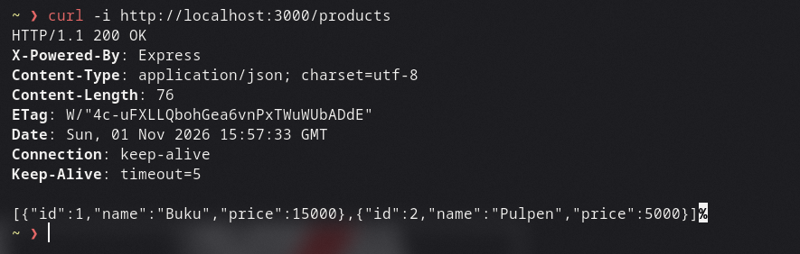
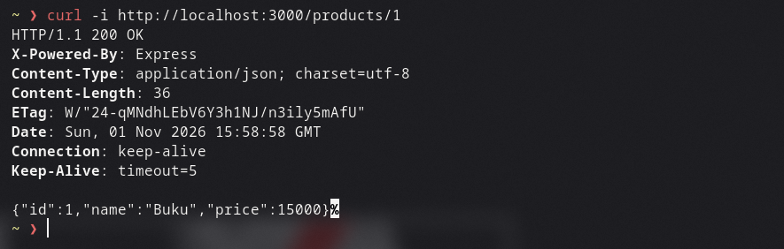
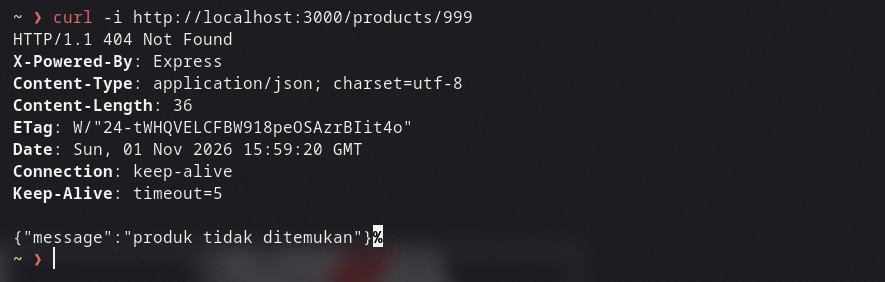
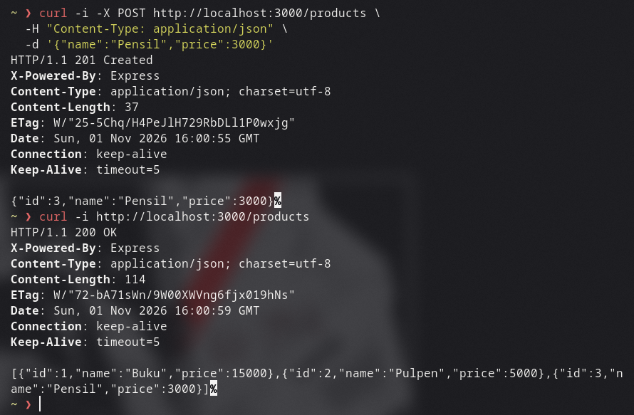

# ExpressJS Simple Product API

A simple product list API built with ExpressJS. Data is stored in an array without a database.

## Running the app

clone my repo and get to it's directory
```sh
git clone https://github.com/catursetyo/express_product_api.git
cd express_product_api
```

install the dependencies
```sh
npm install
```

start the server
```sh
npm start
```

the server runs at http://localhost:3000

## Endpoints

| Method | Endpoint        | Description                                |
| ------ | --------------- | ------------------------------------------ |
| GET    | `/products`     | 200, all products as an array              |
| GET    | `/products/:id` | 200, a single product; 404 if not found    |
| POST   | `/products`     | 201, creates a new product                 |

Details:

- `GET /products` -> returns every product.
- `GET /products/:id` -> returns a single product. If the ID does not exist, it
  responds with `404` and `{ "message": "produk tidak ditemukan" }`.
- `POST /products` -> accepts a JSON body with `name` and `price`, generates a new
  ID (highest ID + 1), and returns the created product with status `201`.

## Testing examples

start the server first, then:

get all products
```sh
curl -i http://localhost:3000/products
```

get product that has ID = 1
```sh
curl -i http://localhost:3000/products/1
```

get product that doesn't exist
```sh
curl -i http://localhost:3000/products/999
```

post new product
```sh
curl -i -X POST http://localhost:3000/products \
  -H "Content-Type: application/json" \
  -d '{"name":"Pensil","price":3000}'
```

## Test results

`GET /products` returns 200 with the full product array



`GET /products/1` returns 200 with the single product "Buku"



`GET /products/999` returns 404 with a JSON message `produk tidak ditemukan`



`POST /products` returns 201 with the created product (id 3, "Pensil"), the second request shows the new product is now part of the list.

