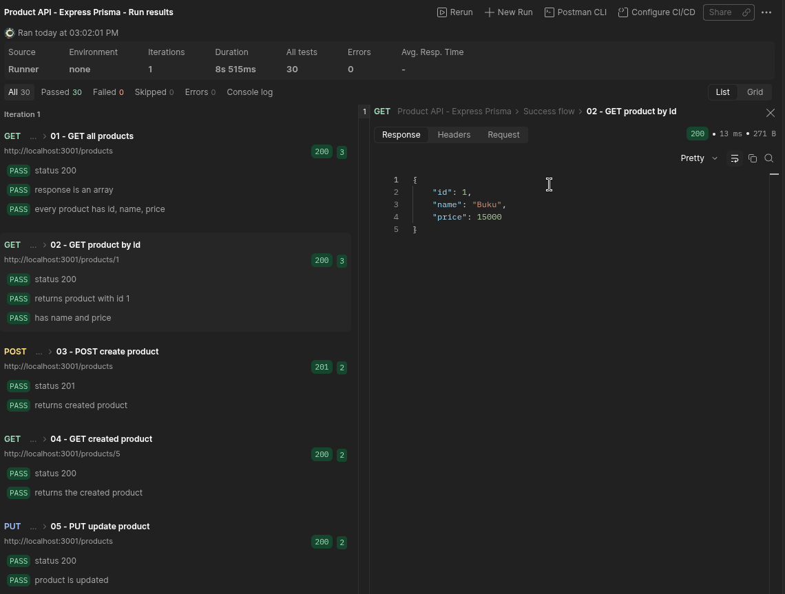
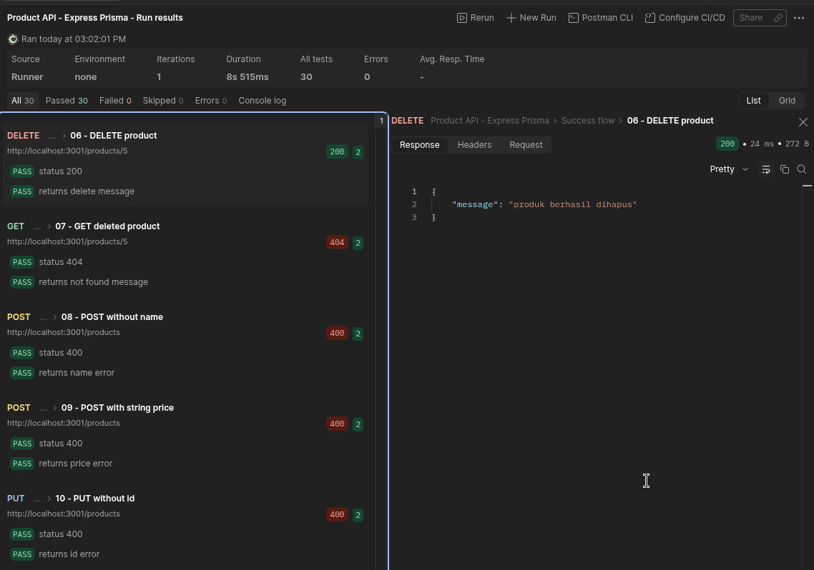
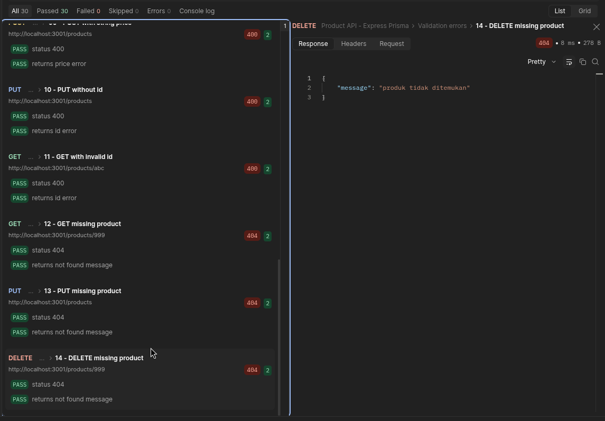

# ExpressJS Simple Product API

A simple product CRUD API built with ExpressJS and Prisma ORM. Data is stored in PostgreSQL.

## Requirements

- Node.js 18+
- Docker (for the local PostgreSQL database)

## Running the app

Clone the repository and move into it:

```sh
git clone https://github.com/catursetyo/express_product_api.git
cd express_product_api
```

Install dependencies:

```sh
npm install
```

Create the environment file:

```sh
cp .env.example .env
```

Start the PostgreSQL container:

```sh
npm run db:up
```

Apply the migration and seed the initial data:

```sh
npm run db:migrate
npm run db:seed
```

Start the server:

```sh
npm start
```

The server runs at http://localhost:3001 (override with the `PORT` environment variable).

## Project structure

```
app.js                            entry point, mounts routes and listens
routes/productRoutes.js           endpoint definitions
middlewares/productMiddleware.js  request validation
controllers/productController.js  Prisma queries
prisma/schema.prisma              database model
prisma/migrations/                migration history
prisma/seed.js                    initial data (Buku, Pulpen)
docker-compose.yml                local PostgreSQL service
.env.example                      database connection template
```

## Endpoints

| Method | Endpoint         | Description                                 |
| ------ | ---------------- | ------------------------------------------- |
| GET    | `/products`      | 200, all products as an array               |
| GET    | `/products/:id`  | 200, a single product; 404 if not found     |
| POST   | `/products`      | 201, creates a new product                  |
| PUT    | `/products`      | 200, updates a product by `id` in the body  |
| DELETE | `/products/:id`  | 200, deletes a product by `id`              |

Details:

- `GET /products` -> returns every product ordered by id.
- `GET /products/:id` -> returns a single product. Returns `404` with
  `{ "message": "produk tidak ditemukan" }` if the id does not exist.
- `POST /products` -> accepts `{ "name": "...", "price": 0 }` and returns the
  created product with status `201`.
- `PUT /products` -> accepts `{ "id": 1, "name": "...", "price": 0 }` and returns
  the updated product with status `200`.
- `DELETE /products/:id` -> removes the product and returns
  `{ "message": "produk berhasil dihapus" }`.

Validation errors return `400`:

| Condition                          | Message                                        |
| ---------------------------------- | ---------------------------------------------- |
| `name` missing or empty            | `name wajib diisi`                             |
| `price` not an integer or below 0  | `price wajib berupa bilangan bulat minimal 0`  |
| `id` not a positive integer        | `id tidak valid`                               |

## Testing examples

Start the server first, then:

```sh
# get all products
curl -i http://localhost:3001/products

# get product with id 1
curl -i http://localhost:3001/products/1

# get a product that does not exist
curl -i http://localhost:3001/products/999

# create a product
curl -i -X POST http://localhost:3001/products \
  -H "Content-Type: application/json" \
  -d '{"name":"Pensil","price":3000}'

# update a product
curl -i -X PUT http://localhost:3001/products \
  -H "Content-Type: application/json" \
  -d '{"id":1,"name":"Buku Tulis","price":20000}'

# delete a product
curl -i -X DELETE http://localhost:3001/products/2
```

## Testing with Postman

The ready-to-import collection is at
`postman/Product-API.postman_collection.json`.

1. Start the database and the server:

   ```sh
   npm run db:up
   npm start
   ```

2. In Postman, click **Import**, select the collection file, and open it.
3. The collection uses the variable `baseUrl` with value
   `http://localhost:3001`. Change it in the collection variables if your server
   runs on another port.
4. Open the collection, click **Run**, and use the Collection Runner.
   Run the requests in order: `03 - POST create product` saves the new product
   id into the `productId` variable that the following requests use.
5. Expected result: 14 requests, 30 assertions, 0 failures.

The `Success flow` folder covers GET, POST, PUT, and DELETE. The
`Validation errors` folder covers missing name, invalid price, invalid id, and
not-found cases.

To reset the database to the seed data before running the collection:

```sh
npx prisma migrate reset --force
```

You can also run the collection from the terminal:

```sh
npx newman run postman/Product-API.postman_collection.json
```

## Database

Check the table before and after a request:

```sh
docker exec express_product_db psql -U postgres -d product_api \
  -c 'SELECT * FROM "Product" ORDER BY id;'
```

## Test results





